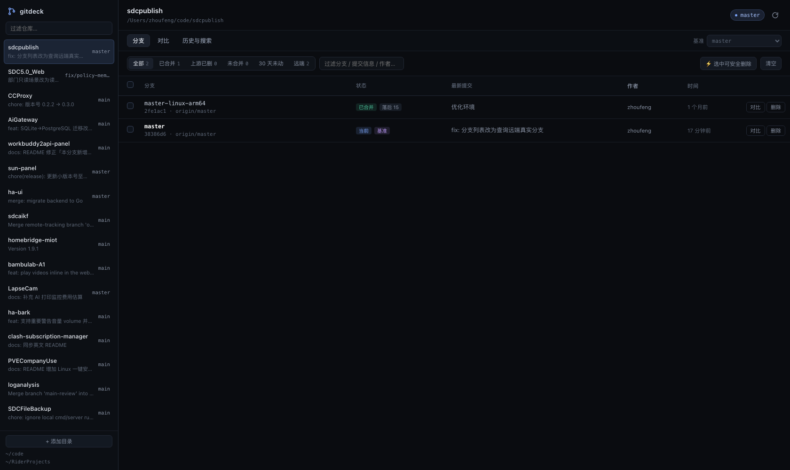
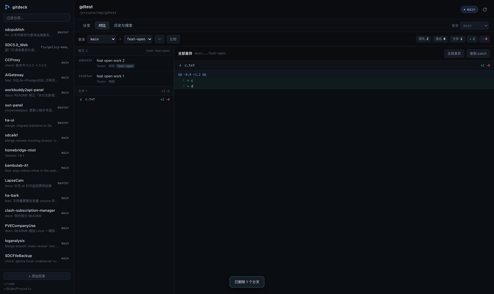
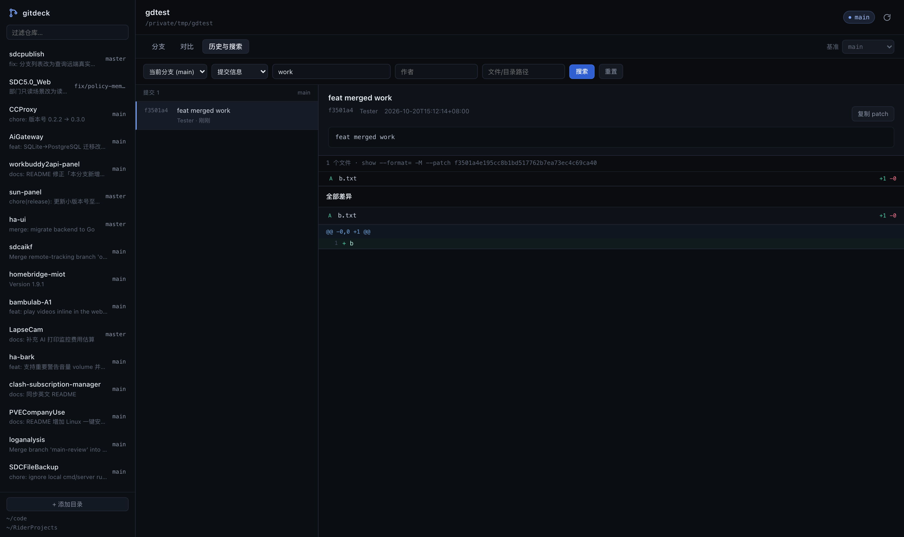
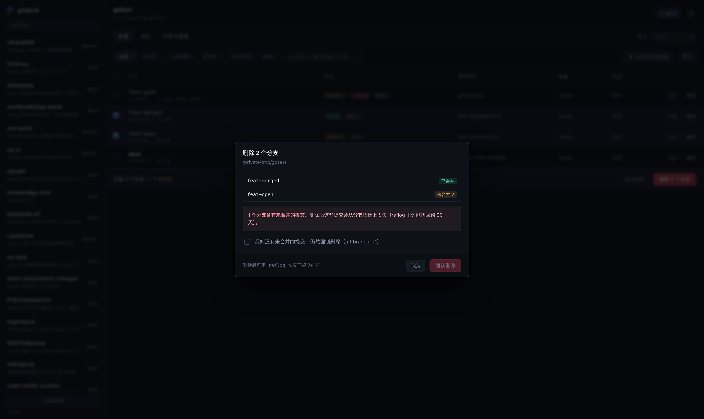
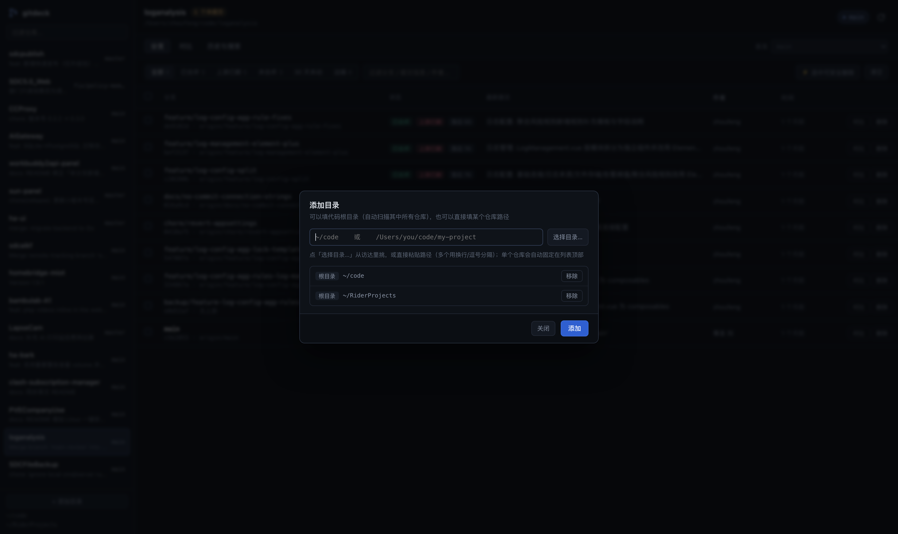

# gitdeck

本地 Git 分支工作台。为一个具体痛点做的工具：**分支太多想快速清掉、想一眼看清某个分支相对 main 到底改了什么**。

窗口里点两下就能删分支，选中分支直接看它和基准分支的差异。

> **技术栈：Rust + Tauri**。后端是纯 Rust（axum + tokio）直接调 git，前端是原生 JS 单页，编译期打进同一个可执行文件。
> 整个 app 只有 **4.6MB**（原来内嵌 Node 是 112MB），无 Node、无运行时解压，双击即开。
>


---

## 功能

| 需求 | 实现 |
| --- | --- |
| 快速删分支 | 勾选批量删除；一键「选中可安全删除」（已合并 / 上游已删）；删除前列出未合并提交数，强制删除需要二次确认；可同时 `git push --delete` 删远端 |
| 本地 + 远端分支同表展示 | 「全部」视图里本地分支之后接一段「远端分支」分组，标出远端、是否已有本地同名分支、相对基准的领先/落后；可直接勾选删除远端（走 `push --delete`） |
| 被 worktree 占用的分支 | 分支行标注 `worktree · N 处改动`；删除时先列出 worktree 路径与未提交改动数，需勾选「同时移除 worktree」，有未提交改动还要再确认丢弃 |
| 分支 vs 基准分支 | 基准分支可选，实时算 ahead/behind，列出独有提交、文件级 +/− 统计、逐文件 diff |
| 唤起本地 codex 讲差异 | 在仓库目录里跑 `codex exec -s read-only`，Rust 侧用 SSE 流式推送，右侧抽屉实时显示；可随时「停止」，结束后渲染 Markdown，支持继续追问 |
| 同步远端 | 顶栏「↓」按钮或按 `s`：`fetch --all --prune` 后对当前分支做 `pull --ff-only`；只快进，绝不产生合并提交。分叉 / 有未提交改动时给出明确提示 |
| 添加目录 | 弹窗里可以直接「选择目录…」调系统文件夹选择框，也可以粘贴路径 |
| 仓库置顶 | 鼠标移到仓库上点右侧 ☆ 置顶，置顶项排在最前并与其它仓库用分隔线隔开；再点 ★ 取消。置顶列表存在 `~/.gitdeck.json` 的 `pins` 里 |
| 变更历史 / 实际文件变化 | 提交列表 → 提交详情 → 文件列表 → diff；合并提交按第一父提交展示（单文件 diff 同样按第一父计算） |
| 并排看差异 | diff 区域右上角「统一 / 并排」切换，左右两栏对照行号；选择记在 localStorage |
| 关键词搜索 | 提交信息、代码改动（`git log -S`）、当前代码内容（`git grep`）三种模式 |
| 按文件 / 作者搜 | 作者过滤、路径过滤，可与关键词组合；作者名带历史提交数提示 |

## 三种用法

**1. 桌面 App（推荐）**

macOS 现成产物（自包含，无需安装 Node）：

```
dist/gitdeck.app                     # 双击即可，或拖进「应用程序」
dist/gitdeck-macos-arm64.zip         # 需要拷给别人时用这个
```

Windows 现成产物：

```
dist/gitdeck-windows-x64.exe         # 单文件 3.6MB，双击即用，无需安装
```

只依赖系统自带的 DLL（无 VC++ 运行库、无外部 dll），要求 Windows 10 1803+ / Windows 11（WebView2 运行时，Win11 自带）。

想在 Windows 上自己构建也可以用 `build-windows.ps1`；在 macOS 上交叉编译见文末。

> 无外部依赖、无缓存解压，启动即用。运行时只需要系统里的 **git**。

**2. 只跑接口（调试 / 用 curl 摸接口）**

```bash
cargo run --manifest-path src-tauri/Cargo.toml -- --serve 7318
# 然后浏览器打开 http://127.0.0.1:7318
```

**3. 开发模式**

```bash
npm install
npm run app:dev     # Tauri 窗口 + Rust 热重载
npm run dev         # 旧版 Node 实现（legacy，仅对照用）
```

## 截屏

| | |
| --- | --- |
|  |  |
| 分支列表：状态标签、批量选择、删除 | 分支对比：提交 / 文件 / diff 三栏 |
|  |  |
| 历史搜索：关键词 → 提交 → 实际文件变化 | 删除确认：未合并提交必须显式勾选 |



## 打包

```bash
# macOS（产物：.app，自包含）
npm run app:build

# Windows（PowerShell，产物：gitdeck.exe 单文件 + NSIS 安装包）
powershell -ExecutionPolicy Bypass -File build-windows.ps1
```

Windows 需要：Node 18+、Rust（MSVC 工具链）、Visual Studio Build Tools 的「C++ 桌面开发」、Git for Windows。
Tauri 不能跨平台交叉编译，`.exe` 必须在 Windows 机器上构建（或用仓库内的 GitHub Actions 工作流）。

## 依赖

- **git** —— 必需
- **codex CLI** —— 仅「Codex 解读」需要
  - 安装：`npm i -g @openai/codex && codex login`
  - 未安装时界面会给出提示，其它功能不受影响
  - 自定义路径：`GITDECK_CODEX=/path/to/codex`
  - 一次解读通常 1–3 分钟（codex 会真的去读代码），期间可随时「停止」
- 打包版已内嵌 Node 运行时，无需另行安装

## 快捷键

| 键 | 动作 |
| --- | --- |
| `r` | 刷新：重新读取分支与工作区状态（不访问远端） |
| `s` | 同步：fetch 远端（含 prune）+ 快进拉取当前分支 |
| `Esc` | 关闭弹窗 / 右侧抽屉 |

## 数据与配置

- 仓库根目录记录在 `~/.gitdeck.json`，界面左下角「添加目录」可随时加
- 默认扫描 `~/code`、`~/Projects`、`~/Documents/GitHub` 等常见目录
- 桌面版首次启动会把内嵌运行时释放到用户缓存目录（macOS：`~/Library/Caches/dev.zhoufeng.gitdeck`，Windows：`%LOCALAPPDATA%\dev.zhoufeng.gitdeck\cache`）

## 安全边界

- 只监听 `127.0.0.1`，随机端口，不对外暴露
- codex 以 `-s read-only` 沙箱运行，不会改动工作区
- 删除分支：当前分支、基准分支、`main/master/develop/release` 等服务端直接拒绝；有未合并提交时必须显式勾选强制删除

## 在 macOS 上交叉编译 Windows 版

Tauri 官方不支持跨平台编译，但纯 Rust 依赖可以用 `cargo-xwin` 做出来：

```bash
rustup target add x86_64-pc-windows-msvc
cargo install cargo-xwin --locked
npm run win:build          # 见 package.json，等价于下面的命令
```

```bash
cd src-tauri
RC=$(brew --prefix llvm)/bin/llvm-rc \
  cargo xwin build --release --target x86_64-pc-windows-msvc
# 产物：src-tauri/target/x86_64-pc-windows-msvc/release/gitdeck.exe
```

注意两点：

- 链接需要 `lld-link`。若 rustup 自带的 `rust-lld` 报 `Library not loaded: @rpath/libLLVM.dylib`，
  用一个静态链接的 `rust-lld` 替换它（本机做法：从另一个 rustup 工具链复制，原文件备份为 `rust-lld.dynamic.bak`）。
- MSVC 的 `rc.exe` 用 LLVM 的 `llvm-rc` 代替（`RC=` 环境变量）。

交叉编译产物没有在 Windows 真机上跑过，逻辑与 macOS 版同源；如需绝对稳妥，用 GitHub Actions 的
`.github/workflows/build.yml` 在 Windows runner 上出包。

## 结构

```
server.js                 后端：git 封装 + 搜索 + 删除 + codex SSE（零依赖，Node 标准库）
public/                   前端：原生 JS，无构建步骤
src-tauri/src/main.rs     桌面外壳：释放内嵌运行时 → 起服务 → WebView 打开
scripts/prepare-resources.js  打包前把 server.js / public / node 复制进 src-tauri/resources
```

## 已知限制

- 分支 ahead/behind 按分支数量逐个计算，几百个分支的仓库首次加载会慢几秒
- diff 单文件上限 800KB，界面最多渲染 9000 行，超出会提示截断
- Windows 依赖系统 WebView2（Win11 自带，Win10 新版一般也有）
